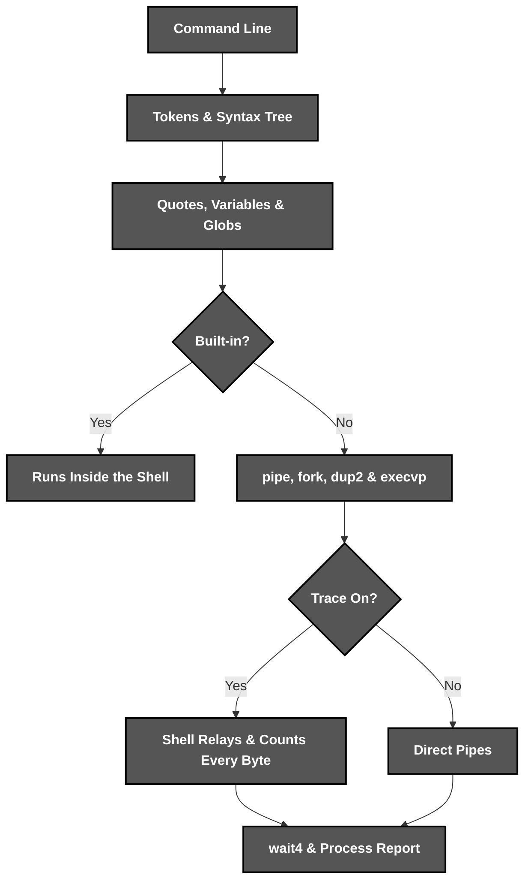
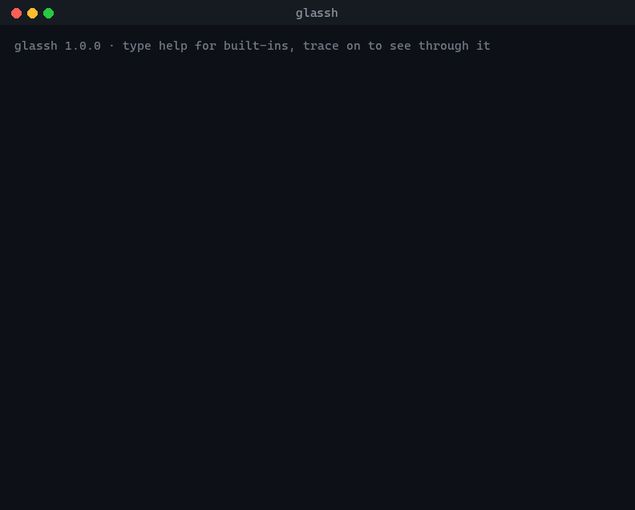

<div align="center">

<br><br>


*A **see-through** Unix shell that narrates its own **system calls***

</div>

# 📝 **Description**

<div align="center">

***Glassh*** is a **POSIX shell written in C** that runs pipelines, redirections and jobs, and on demand shows every ***pipe***, ***fork*** and ***exec*** it makes with a report of each process
</div>
<br>
<div align="right">

***It was born as a second-year university project*** 🎓

</div>

# 🛠️ **Glassh Architecture & Workflow**

<div align="center">


</div>

# 📁 **Project Structure**

```
glassh/
├── .clang-format                                       # Code Style Configuration
├── .gitattributes                                      # Git Attributes Configuration
├── .gitignore                                          # Git Ignore Rules
├── LICENSE                                             # Project License
├── Makefile                                            # Build, Test & Install Targets
├── README.md                                           # You are here! ⬅️
│
├── .github/workflows/
│   └── ci.yml                                          # Format, Test & Sanitizer Pipeline
│
├── assets/                                             # Visual Assets
│   ├── demo.gif                                        # Recorded Trace Session
│   └── logo.svg                                        # Glassh Logo
│
├── src/
│   ├── glassh.h                                        # Shared Types & Interfaces
│   ├── main.c                                          # Prompt, Terminal & Input Loop
│   ├── parse.c                                         # Tokenizer, Parser & Explain
│   ├── expand.c                                        # Quotes, Variables & Globs
│   ├── exec.c                                          # Pipelines, Relay & Waiting
│   ├── jobs.c                                          # Background & Stopped Jobs
│   ├── builtins.c                                      # Built-in Commands
│   └── trace.c                                         # Narration & Process Report
│
└── tests/
    └── run.sh                                          # End-to-End Test Suite
```

# 🔧 **Installation**

## 📋 Requirements

- **Linux or macOS**
- **A C11 compiler** (GCC or Clang)
- **Make**

## ⚙️ Quick Setup

1. **Clone the repository**
   ```bash
   git clone https://github.com/cristiangilsanz/glassh.git
   cd glassh
   ```

2. **Build Glassh**
   ```bash
   make
   ```

3. **Start the shell** *(or install it with `sudo make install`)*
   ```bash
   ./glassh
   ```

<br>

# 🚀 **See *Glassh* in Action**

<div align="center">
    
</div>

## 🔍 To See Through a Pipeline:

1. **Turn tracing on, from the prompt or with `glassh --trace`:**

```bash
trace on
```

2. **Run any pipeline and watch every system call:**

```
glassh ~ ◉ trace ❯ printf "one two three" | tr " " "\n" | sort -r > words.txt
  · pipe() = [3, 4]
  · pipe() = [5, 6]  relay through the shell to count bytes
  · fork() = 1193  →  printf "one two three"
  · pipe() = [4, 8]
  · pipe() = [9, 11]  relay through the shell to count bytes
      ╰─ 1193 dup2(4, 1)
      ╰─ 1193 execvp("printf")
  · fork() = 1194  →  tr " " "\n"
      ╰─ 1194 dup2(5, 0)
      ╰─ 1194 dup2(8, 1)
      ╰─ 1194 execvp("tr")
  · fork() = 1195  →  sort -r > words.txt
      ╰─ 1195 dup2(9, 0)
      ╰─ 1195 open("words.txt", O_WRONLY|O_CREAT|O_TRUNC) = 3
      ╰─ 1195 dup2(3, 1)
      ╰─ 1195 execvp("sort")
  · wait4() = 1193
  · wait4() = 1194
  · wait4() = 1195
┌─ 3 processes in 2.98 ms
│    1193  printf "one two three"  exit 0      0.67 ms   cpu   0.62 ms      1.8 MiB
│          └─▶ 13 B
│    1194  tr " " "\n"             exit 0      0.58 ms   cpu   0.00 ms      1.7 MiB
│          └─▶ 13 B
│    1195  sort -r > words.txt     exit 0      2.62 ms   cpu   0.75 ms      2.2 MiB
└─ status 0
```

3. **Each process shows its exit code or signal, wall time, CPU time and peak memory, and each pipe shows the bytes that flowed through it**

## 🌳 To Explain a Line Without Running It:

1. **Ask Glassh how it reads a command line:**

```bash
explain 'sort < names.txt | uniq -c > counts.txt &'
```

```
background job
└─ pipeline of 2 commands
   ├─ sort
   │   stdin  < names.txt
   └─ uniq -c
       stdout > counts.txt
```

## ⚙️ To Use It as a Shell:

1. **Pipes, redirections, conditions and jobs work as in any Unix shell:**

```bash
grep -v '^#' /etc/services | sort -u > services.txt 2>&1
make && ./app || echo "build failed: $?"
sleep 30 &
jobs
```

2. **Press Ctrl-C to interrupt the foreground job, or Ctrl-Z to stop it and resume it later with `fg` or `bg`**

## 🧪 To Run the Tests:

1. **Build and run the end-to-end suite:**

```bash
make test
```

2. **Run it under AddressSanitizer and UndefinedBehaviorSanitizer:**

```bash
make clean && make CC=clang CFLAGS="-g -fsanitize=address,undefined" LDFLAGS="-fsanitize=address,undefined" test
```

## ⌨️ Built-in Commands

<div align="center">

| Command | Action | Description |
|:---:|---|---|
| `trace [on\|off]` | See Through | Narrates system calls and reports every pipeline |
| `explain LINE` | Show Parse Tree | Prints how a line is parsed, without running it |
| `cd [dir\|-]` | Change Directory | Moves to a directory, `-` goes back |
| `export NAME=value` | Set Variable | Exports a variable to every child process |
| `unset NAME` | Remove Variable | Removes variables from the environment |
| `jobs` | List Jobs | Shows background and stopped jobs |
| `fg [%n]` / `bg [%n]` | Resume Job | Continues a job in the foreground or background |
| `wait` | Wait for Jobs | Blocks until every background job finishes |
| `copy SRC DST` | Copy File | Copies a file with raw `read()` and `write()` calls |
| `exit [code]` | Leave | Exits the shell |

</div>

## 📄 Syntax

<div align="center">

| Syntax | Meaning |
|:---:|---|
| `a \| b` | Pipes the output of `a` into `b`, with any number of stages |
| `< file` / `> file` / `>> file` | Redirects input, output or appended output |
| `2> file` / `2>> file` / `2>&1` | Redirects errors, also accepting the original `!> file` |
| `a && b` / `a \|\| b` | Runs `b` only if `a` succeeds or fails |
| `a ; b` / `a &` | Runs commands in sequence or in the background |
| `'text'` / `"$VAR"` / `\x` | Literal quotes, expanding quotes and escapes |
| `$VAR` / `${VAR}` / `$?` / `$$` / `~` | Variables, last status, shell pid and home |
| `*` / `?` / `[a-z]` | File name globs |
| `NAME=value cmd` | Sets a variable for one command only |
| `# comment` | Ignores the rest of the line |

</div>

# 💡 **Tips for Best Results**

The following tips help you get the most out of ***Glassh***:

> - Try ***yes | head -1*** with tracing on to watch SIGPIPE stop a process.
> - Run scripts with ***glassh script.sh*** or one-liners with ***glassh -c 'line'***.
> - Set ***NO_COLOR=1*** to turn colours off.

# 📚 **Tech Stack & Other Resources**

## 📦 Tech Stack

### 🧩 **Programming Language**
- [C11](https://en.cppreference.com/w/c/11)

### 🐧 **Operating System Interfaces**
- [POSIX](https://pubs.opengroup.org/onlinepubs/9699919799/)

### 🔨 **Build**
- [GNU Make](https://www.gnu.org/software/make/)

### 🧪 **Testing**
- [Bash](https://www.gnu.org/software/bash/)
- [AddressSanitizer](https://clang.llvm.org/docs/AddressSanitizer.html)
- [UndefinedBehaviorSanitizer](https://clang.llvm.org/docs/UndefinedBehaviorSanitizer.html)

### 🧹 **Code Quality**
- [clang-format](https://clang.llvm.org/docs/ClangFormat.html)

### ⚙️ **Continuous Integration**
- [GitHub Actions](https://docs.github.com/actions)

# 🙏 **Credits & Thanks**

This project was created together with ***Alejandro Jiménez Valero*** and ***Eduardo Alconada Sola*** 🤝 in our second year of university.

Thanks to everyone who keeps the Unix man pages so readable ✨.

# 📄 **License**

This project is licensed under the MIT License - see the [LICENSE](LICENSE) file for details.

# 📞 **Get Help & Connect**

- 🐛 [Open an issue](https://github.com/cristiangilsanz/glassh/issues)
- 📧 cristiangilsanz@gmail.com

<div align="center">
  <br>

  **Made with 💖 for the Unix Community**

  [⭐ Star this repo](https://github.com/cristiangilsanz/glassh) | [🍴 Fork it](https://github.com/cristiangilsanz/glassh/fork)

  <br>

  <a href="https://www.buymeacoffee.com/cristiangilsanz" target="_blank">
    
  </a>

</div>
